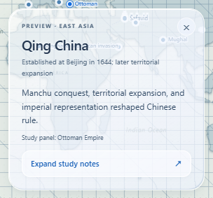
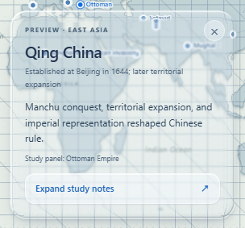
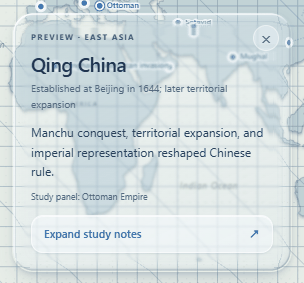
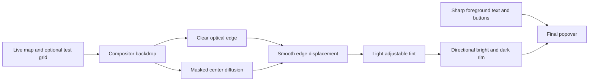
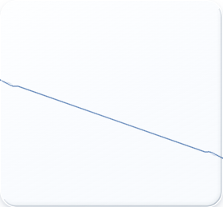
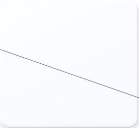

# Qing China: live-glass optical audit and comparison

**Approved follow-up:** all location preview cards now use B · Refined with **Tinted 100%** as their default. Trial-era tint preferences are superseded once; later adjustments remain user-controlled. The diagnostic grid defaults off, including in the lab. The captures and measurements below document the original Qing comparison at 28% tint; the layout, navigation and reading panels remain unchanged.

[Open the interactive A/B diagnostic](https://eason0914.github.io/history-atlas/glass.html?prototype=live-map&diagnostics=glass&unit=unit3&v=optics2). It opens the Qing China preview, a thin grid in the actual moving map scene, and temporary controls. Select A or B at the **same position**; drag the exposed map or use the zoom buttons. **Hold card still** separates backdrop movement from marker following. Closing diagnostics removes the grid and restores normal following.

[Open the normal map-first page](https://eason0914.github.io/history-atlas/glass.html?prototype=live-map&unit=unit3&v=optics2) for the refined Qing card without any diagnostic overlays. Other marker previews, navigation, the layout, the Classic ocean, and long reading panels retain their existing materials/layouts. This iteration changes the Qing material first.

## What the audit established before changing the renderer

The previous Qing popover **already had genuine live background distortion in Chromium**. Its background-only span used `backdrop-filter: url(#atlas-live-preview) saturate(1.08)`. The filter's `feDisplacementMap` operated on live `SourceGraphic`. Its embedded PNG encoded surface normals, not a map screenshot. An independent stripe probe inside the actual map produced a 16.37/255 mean pixel difference with displacement enabled versus disabled, with no blur in that comparison. This is a difference metric, not a displacement distance.

The visual problem was above that optical layer: a 61–78% pale white fill, a 93%-opaque uniform white border, and an almost uniform inset highlight. Those layers obscured much of the background information that makes glass recognizable. The older edge profile also concentrated its strongest bending at the outer lip, with a hard displacement cap. It had no separate readability diffusion mask. [Raw audit](assets/diagnostics/audit-previous.json).

The full card and its text were not filtered. Its normal map geometry remained live; unrelated photographs were not used by this renderer.

## A/B captures

These are unretouched browser captures of the same Qing card at the same camera, position, size, foreground content, and diagnostic grid. Only the material changes. A preserves the previous renderer and fixed tint; B uses the refined material at the default 28% slider setting.

| A · Previous material | B · Refined material |
| --- | --- |
|  |  |

The grid is deliberately stronger than the normal geographic graticule to make displacement observable. It is off outside the diagnostic URL and can be removed immediately with the Thin grid checkbox or Close.

Actual input-driven pan, with the glass stationary and the foreground text unchanged:

## Refined optical technique

The original map, camera, content, and three-column arrangement are retained. The native path continues to read the **live compositor backdrop**. A rounded-rectangle signed-distance field supplies smooth surface normals around all four sides and corners. A finite convex shoulder and Snell-inspired ray calculation produce a continuous displacement profile, normalized to six CSS pixels. The edge band is at most 22px wide; the center has zero displacement. Correcting the 128/255 neutral-map bias keeps the center exactly neutral in the test.

The component's inner dimensions are used for the optical textures, instead of the previous outer border-box dimensions. That aligns the normal field and highlight more closely with the actual sampling surface.

- **Readable diffusion:** a separate mask introduces restrained Gaussian diffusion in the reading area, while leaving the outer optical band clear. At the default setting, the standard deviation is 1.05px. Foreground text never passes through that filter.
- **Tint:** the Ultra-clear → Tinted slider ranges from 7% to 78% peak tint. The default peak is 26.9%, compared with the previous 78%. It uses a cool neutral tint rather than an opaque white reading card. Tint/diffusion preferences save locally and apply to B; A keeps its previous fixed appearance for a fair comparison.
- **Directional light:** a surface-normal light texture paints a brighter upper/left reflection and a subtle dark lower/right rim. A thin pointer-sensitive highlight adds restrained response; it does not regenerate the normal texture or animate the whole card. The frame uses a transparent border rather than a uniform white outline.
- **Stable following:** card position uses fractional coordinates and placement hysteresis. Diagnostic pinning holds the card still while the source map moves; ordinary mode follows the marker. Pointer-transparent optical layers preserve map gestures.
- **Scope:** no decorative ocean texture, static map capture, or chromatic fringing is added. Navigation pills and long reading panels have not received the new material in this iteration.

## Preview versus selected lesson

Different names in a preview and the right panel were intentional: opening a preview did not commit a new lesson until **Expand study notes**. The presentation was ambiguous because both markers used similar solid blue states.

The card now says **Preview**, names the currently open study panel, and gives an uncommitted preview a hollow/dashed marker. The current lesson keeps its filled selected marker and active sidebar row. Expand updates the lesson, marker selection, and sidebar together. Filter-driven selection changes also update the preview context, preventing stale labels.

## Acceptance results

29 focused optics checks, all 28 previous prototype checks, and all 43 classroom/content/edition checks passed in Chrome on Windows. Desktop, mobile emulation, native compositor and forced SVG fallback captures were inspected.

| Acceptance | Evidence |
| --- | --- |
| Moving the map changes the content behind stationary glass | Real pointer drag and zoom changed sampled pixels while card position stayed within 0.1px; motion capture above. |
| Lines bend instead of only becoming blurry | With Gaussian diffusion set to zero, a diagonal line inside the map moved **2.10px** near the rim. At 50px and 140px into the card, measured displacement was **0.00px**. |
| Foreground remains sharp | Text and card container filters/backdrop filters remained `none`; only the separate optical span is filtered. |
| Directional bright/dark edges | The generated light map was checked for a white upper reflection and dark lower pixels, then visually inspected. |
| Gestures and layout remain usable | Real drag, zoom, marker following, Expand, focus handling, viewport bounds, accessibility preferences, unchanged geography and source counts passed. No perpetual idle render loop was observed. |

The line probe below was drawn inside the actual map scene. Only displacement was toggled; diffusion was disabled for this proof. Foreground was hidden temporarily to measure the thin line and was restored afterward. This measurement probe is not shipped in the normal page.

| Displacement enabled | Displacement disabled |
| --- | --- |
|  |  |

[Detailed checks and measured offsets](assets/diagnostics/optics-checks.json). Screenshots and timing/idle checks establish the tested behavior; they are not a universal frame-rate guarantee.

## Browser strategy and performance limits

The native route is selected for Chromium with SVG URL backdrop-filter support. For other engines, the existing fallback references the original `#map-world` through SVG `<use>`, aligns its screen transform, and applies the **same refined filter** to that live vector scene. It follows pan, zoom, labels, markers and the diagnostic grid. It does not reproduce arbitrary HTML behind the pane. Use `&glassRenderer=svg` to inspect this fallback in Chromium.

SVG URL backdrop filters are not interoperable across browser engines; see the [WebKit implementation issue](https://bugs.webkit.org/show_bug.cgi?id=245510). Safari/Firefox and physical iPhones have not been directly tested in this environment. The implemented fallback was exercised in Chromium. Reduced transparency and forced colors use an opaque accessible surface; reduced motion disables decorative motion.

Only the small Qing pane gets the more involved filter. Three bounded optical textures are generated on size/material changes; tint changes update a filter value and a CSS variable without rebuilding them. Pointer highlights and marker positioning use coalesced event-driven frames. There is no continuous animation loop, canvas map rasterization, or repeated DOM screenshot capture.

## References inspected

- [Apple, WWDC26 Platforms State of the Union](https://developer.apple.com/videos/play/wwdc2026/102/): the transcript describes stronger diffusion of complex backgrounds, darker edges, brighter reflections and user-adjustable clarity/tint. These are design goals for this web interpretation, not a claim to use Apple's native renderer.
- [archisvaze/liquid-glass SVG source](https://github.com/archisvaze/liquid-glass/blob/main/index.html): surface-profile generation, normal-map displacement, background diffusion and a separate specular map were inspected.
- [Its WebGL source](https://github.com/archisvaze/liquid-glass/blob/main/webgl.html): its shader samples a supplied `uBgTex` loaded by `TextureLoader`, with multi-sample diffusion and directional light. It does not capture a live HTML map. Copying that demo's background-image path would therefore not meet this atlas's live-map requirement.

The atlas code is original. `glass-material.js` owns optical texture generation; `live-glass.js` integrates the filter and existing preview; `glass-diagnostics.js` owns the temporary A/B/grid/pinning tools; `glass-material.css` scopes the visual refinement to Qing. No reference-demo code or photo texture is bundled for this material.
